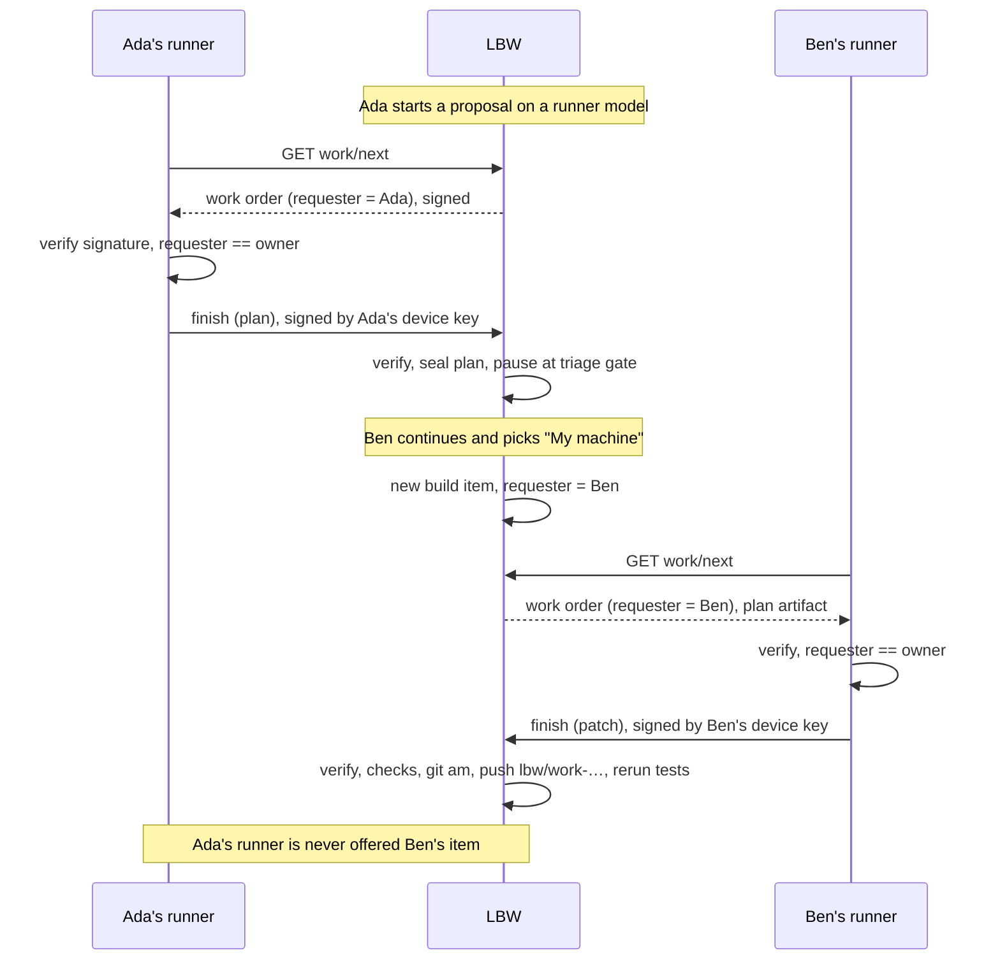

# Runner spec: local work, many tools, one owner per machine

Status: proposed. Builds on the prototype in PR #90 (`local-runner`), whose
design is `docs/runner.md`. This page is what to build next and in what order.

## Summary

A runner is a person's own machine linked to LBW. Today it does one thing: take
a build job, run that person's Claude Code, send a patch back. LBW applies it,
runs the tests, and opens the pull request.

This spec widens it in three directions:

1. **Many tools.** A runner hosts drivers: Claude Code, Codex, Cursor's agent
   CLI, and LBW's own agent loop. One driver runs one piece of work.
2. **Local models.** An organization can turn on models that run on each
   person's machine, such as Ollama, LM Studio, or vLLM. LBW never calls them.
   The runner does.
3. **Whole proposals on the machine, continued by others.** A proposal splits
   into work items: plan, build, review, test. Any of them can run on a runner.
   A finished item is published to LBW. When another person continues the
   proposal, asks for changes, or reruns it, the next item runs where **that
   person** chooses: on their own runner, or in LBW with their credentials.

## The rule this spec is built around

**A runner only ever runs work and commands that its own owner asked for.**

When someone other than the owner asks for anything, it goes to that person's
own runner, or to LBW with that person's credentials, or it is refused. This
covers starting a job, continuing at a gate, asking for changes, rerunning,
and maintenance such as updating a tool or pulling a model. It is never sent to
the original requester's runner, or to anyone else's.

This holds even if LBW's routing has a bug. Two checks enforce it
independently:

- LBW never offers an item to a runner whose owner is not the item's acting
  person. This is a database condition on the lease, not a filter in code.
- The runner verifies a signed work order before it runs anything. It refuses
  work whose requester is not the person it is linked to (see Security model).

There is no shared pool. A person's runner never picks up a coworker's request
on its own. A coworker's work reaches your machine only when you act on it
yourself in LBW. At that point you are the requester of the next item.

## Terms

| Term | Meaning |
|---|---|
| Runner | `lbw-runner` on one person's machine, linked with a device code. Exactly one owner, fixed at link time. |
| Owner | The person who approved the runner's link code. The only person whose work it runs. |
| Driver | An adapter inside the runner that runs one tool headlessly and turns its output into LBW events. |
| Capability | What a runner can do now: its drivers and their versions, the local providers it reaches, the model names it has. Reported each heartbeat. |
| Work item | One phase of one task (`plan`, `build`, `review`, `test`) with one requester and one place to run. |
| Requester | The person whose action created this work item: started the job, continued it, asked for changes, or reran it. |
| Work order | What LBW hands a runner for one item or one command. Signed by LBW and naming the requester. The runner checks it before running anything. |
| Artifact | What one item hands to the next: a plan, a patch on a work branch, review notes, a test summary. |

## Goals

- An organization owner or admin chooses which drivers and which local model
  providers its people may use on runners.
- A model endpoint can say "runs on each person's machine" for Claude, for
  Codex and Cursor, and for local providers such as Ollama. Choosing that model
  picks the driver, and the runner is always the requester's own.
- A whole proposal can run locally: plan, build, review, and tests on one
  machine, with the result published to LBW for the gates, history, usage, and
  the pull request.
- When another person continues, reworks, or reruns a proposal, the next item
  runs on their runner or in LBW with their credentials. They choose where.
- Progress, usage, audit, and history look the same wherever the work ran, and
  show who requested each item and where it ran.
- LBW survives restarts and runs as more than one process without losing
  runner work. The in-memory hub stops being the source of truth.

## Not goals

- Running anyone's request on a runner they do not own, for any reason,
  including load balancing, availability, or an admin's request.
- A shared pool of work that runners claim on their own.
- Shared service runners that hold one organization-wide credential. That is
  the Docker image with an API key, and it stays an organization-key endpoint.
- A runner pushing to the repository, or LBW storing any tool's login.
- Replacing LBW's server-side loop. Server-side models keep working unchanged.

## Security model

### What is bound to what

| Binding | How | Where it is kept |
|---|---|---|
| Runner ↔ owner | Set when the owner approves the device code while signed in. Never changes. A different person means a new link. | `runners.identity_id`, and the runner's local `owner` record |
| Runner ↔ device | The runner makes an Ed25519 key pair at link time. The private key never leaves the machine. LBW stores the public key. | Private key: OS secret store (Keychain or Secret Service; else a `0600` file). Public key: `runners.public_key`. |
| Runner ↔ LBW | The runner pins LBW's work-order signing public key at link time. | Runner config. On LBW, the signing private key lives next to the master key in `.lbw/`, not in the database. |
| Runner ↔ session | The existing bearer token. Only its hash is stored. | `runners.token_hash` |

Go's `crypto/ed25519` and the server's existing `cryptography` dependency cover
this. The signing key signs. It does not encrypt, so it is not a second cipher.
Secrets are still sealed only by `runtime/store/crypto.py`.

### Linking

1. `lbw-runner login` makes the key pair and calls `POST /api/runner/link` with
   its public key.
2. The owner enters the code on Profile, Your machines, while signed in.
3. `POST /api/runner/link/token` returns:
   - the runner token;
   - the owner's `identity_id`, `tenant_id`, and display name;
   - LBW's work-order public key.
4. The runner stores the owner and LBW's public key locally. It refuses to
   change either afterwards. Relinking makes a new runner.
5. The runner signs the link proof (link code plus public key) with its new
   private key, so LBW knows the key that registered is the one that holds the
   token.

### Work orders

LBW sends every job item and every command as a work order. The fields:

```json
{
  "order_id": "wo_…",
  "kind": "work | command",
  "tenant_id": "…",
  "runner_id": "…",
  "owner_id": "…",
  "requester_id": "…",
  "task_id": "…",
  "item_id": "…",
  "phase": "plan | build | review | test",
  "command": "update_tool | pull_model",
  "driver": "claude_code",
  "model": "opus",
  "base_commit": "…",
  "inputs_sha256": "…",
  "issued_at": 0,
  "expires_at": 0,
  "nonce": "…"
}
```

`task_id`, `item_id`, and `phase` apply to `work` orders. `command` applies to
`command` orders.

`inputs_sha256` covers the goal text and the artifacts handed with the order,
so they cannot be swapped after signing. LBW signs the canonical JSON with its
work-order key.

**The runner runs nothing until every check passes:**

1. LBW's signature is valid under the pinned public key.
2. `runner_id` is this runner. `tenant_id` and `owner_id` match the owner
   stored at link time.
3. `requester_id` equals `owner_id`. Otherwise refuse.
4. `expires_at` is in the future (orders live at most five minutes before
   pickup), and `nonce` has not been seen before. The runner keeps recent
   nonces until their orders expire.
5. The hash of the inputs it received equals `inputs_sha256`.
6. The driver is one this runner has, and the tool set is within the
   organization's ceiling carried in the order.

On a refusal the runner reports `refused` with the failed check, and runs
nothing. LBW fails the item with that reason and writes `runner.refused` to the
audit trail. A refusal for check 3 also raises an alert for the organization's
owners. It means LBW tried to route someone else's work to this machine.

### Results

The runner signs its finish message with its device key. The message is the
item id, the order id, the SHA-256 of the patch, and the SHA-256 of each
artifact. LBW verifies it against `runners.public_key` before applying
anything. A result that fails verification is dropped, and the item fails with
`task.patch_rejected`.

### On LBW's side

- A lease is only granted where `runners.identity_id = work.requester_id` and
  `runners.tenant_id = work.tenant_id`. This is part of the `UPDATE … WHERE`
  that takes the lease, so no code path can lease around it.
- Every route that creates a work item sets its `requester_id` to the
  signed-in person who made the request. No route accepts a requester from the
  client.
- Commands (`update_tool`, `pull_model`) can only be queued by the runner's
  owner, from their own profile. An admin cannot queue them.
- Revoking a runner, or removing its owner from the organization, ends its
  token. LBW fails the runner's leased items with "runner revoked". It does
  not move them to another runner.

### What this does not protect against

The runner trusts LBW's statement of who the requester is. If LBW itself were
compromised, the attacker could sign a work order naming the owner as
requester. Two later steps would close that gap:

- Owner-signed requests: the owner's browser signs the request with a passkey
  bound to their runners.
- Local confirmation: the runner asks the person at the keyboard before it runs
  a phase marked sensitive.

Neither is in the first version. The tool ceiling and LBW's patch checks still
limit what such an order could do.

## When someone else acts on a proposal

| Action by Ben on Ada's proposal | Where the next item runs |
|---|---|
| Continue at a gate | Ben chooses: his runner (a runner model he can run) or LBW (a server model, with Ben's credential). |
| Ask for changes (rework) | Same choice, Ben's runner or LBW with Ben's credentials. |
| Rerun | Same choice. |

- Ben is the requester of every item his action creates. Ada's runner is never
  a candidate.
- The dialog defaults to the proposal's model.
  - If that model runs on runners and Ben has an online runner with its driver
    and model, it runs there.
  - If Ben has no such runner, LBW offers the server models allowed on the
    project. Ben's personal key or sign-in is used where the endpoint asks for
    one, under the existing `409 link_required` rule.
  - If nothing fits, the request is refused with `409 runner_required`, naming
    what is missing. It never falls back to Ada's runner or Ada's credentials.
- If Ada's runner is still running an earlier item when Ben acts, that item is
  cancelled at its next event post. Ben's item starts from the last published
  artifact.
- The audit trail records `task.credentials` for Ben, as gates do today, and
  the job page shows each item's requester and where it ran.

This is the only way work moves between people: a person acts on it in LBW,
and it runs as them.

## Organization enablement

Organization settings get a **Runners** tab. Owners and admins edit it. Members
read it.

| Setting | Values | Default |
|---|---|---|
| Runners allowed | on / off | on |
| Drivers allowed | any of `claude_code`, `codex`, `cursor_agent`, `lbw` | `claude_code` |
| Local providers allowed | any of `ollama`, `lmstudio`, `vllm`, `openai_compatible` | none |
| LBW reruns tests before publishing | always / when the runner's tests failed or were skipped | always |
| Minimum runner version | semver | none |
| Tool ceiling | the widest tool allowlist a driver may be started with | the prototype's read, edit, and git-read set |
| Patch limit | bytes | 5 MB |

There is no setting that lets a runner run another person's work.

Storage: one `runner_policy` row per tenant: `tenant_id`, `policy_json`,
`updated`, `updated_by`. It is settings, not access. Access stays on the
existing project grants. Do not add a second permission table. Every change
writes an audit row (`runner.policy`).

A project can only narrow these settings. It can limit which runner models it
allows from its Models page, but it cannot widen them.

## Models that run on the machine

PR #90 added `auth = runner` for Claude endpoints. This generalizes it.

An endpoint with `auth = runner` gets a `driver` column. The endpoint form
offers it when the organization allows that driver or provider:

| Provider | Driver | Model names | Where the model runs |
|---|---|---|---|
| Claude | `claude_code` | `sonnet`, `opus`, `haiku`, or a full id | Anthropic, through the person's Claude Code login |
| OpenAI | `codex` | names the admin enters | OpenAI, through the person's Codex login |
| Cursor | `cursor_agent` | names the admin enters | Cursor, through the person's Cursor login |
| Ollama, LM Studio, vLLM, OpenAI-compatible | `lbw` (default), or `codex` / `cursor_agent` where the tool can point at a local server | names the admin enters | On the person's machine |

For a local provider the endpoint stores no base URL. Each runner has its own
address for each provider in its config, for example
`"providers": {"ollama": "http://127.0.0.1:11434/v1"}`. That address is never
sent to LBW.

Each heartbeat reports, per allowed provider, the model names the runner can
reach (Ollama `/api/tags`, or `/v1/models` for the others), and, per driver,
whether the tool is installed and signed in. LBW stores that as the runner's
capability (see Schema). In the job form a model shows as:

- "(your machine)" when one of **your** online runners has it;
- "(your machine, not installed)" with the exact pull command when your runner
  reaches the provider but lacks the model;
- not offered when none of your runners reach that provider.

**Pull model** on your own Profile, Your machines queues a signed `pull_model`
command for your runner. The runner runs `ollama pull <name>` and reports back
at the next heartbeat. Only Ollama supports this in the first version.
**Update Claude Code** becomes `update_tool` with the driver named, and is
signed the same way.

## Drivers

Go, standard library only, in `runner/internal/driver/<name>`. One interface:

```go
type Driver interface {
    Name() string                                    // "claude_code", "codex", ...
    Detect(ctx context.Context) Status               // installed, version, signed in
    Run(ctx context.Context, w Work, emit func(client.Event)) Outcome
}
```

- `Work` is built only from a verified work order. It carries the phase, the
  worktree path, the prompt LBW built for that phase, the model name, the tool
  ceiling, the turn limit, and a deadline.
- `Outcome` carries ok/failed, a one-paragraph summary, and, for `plan` and
  `review`, the text the phase produced.
- Every driver maps its own stream to the four event kinds LBW already accepts
  (`step`, `tool`, `llm`, `note`). An `llm` event carries the tokens per model
  the tool reported. LBW drops any other field, as it does today.
- A driver starts its tool with the narrower of the order's tool ceiling and
  the owner's local config.

| Driver | Tool | Notes |
|---|---|---|
| `claude_code` | `claude -p … --output-format stream-json` | Exists in the prototype. Moves behind the interface. |
| `codex` | Codex CLI in non-interactive mode with JSON events | Pin the exact flags in the driver. Cover them with a fake binary, like `fake-claude.sh`. |
| `cursor_agent` | Cursor's agent CLI in print mode with a JSON stream | Same: pin flags, add a fake binary. |
| `lbw` | `lbw run --local --events jsonl` against the provider address | LBW's own plan/build/review loop, run on the machine. Needs the CLI changes below. |

Each driver has a fake-binary test under `runner/internal/testdata/` that
replays a recorded stream. Driver tests never call a real tool or model.

### CLI changes for the `lbw` driver

`lbw run` gains a mode where it does the work and reports it, but does not
commit, push, or open a pull request:

- `--local` keeps everything in the worktree. It never publishes.
- `--phase plan|build|review|test` runs one phase only. With no flag it runs
  all of them.
- `--events jsonl` writes LBW events to stdout, one per line, in the same
  schema the runner forwards.
- `--model`, `--base-url`, and `--api-key-env` pick the local model.
- It reads the plan or review notes it is given from a file (`--input`), so a
  continued proposal can carry the last phase's output.

This is a public seam (`lbw` CLI), so the driver can be tested end to end
against a scripted model, as `tests/` does today.

## Work items and the queue

### From one job to phases

A task today is one request with one outcome. With runners it becomes an
ordered list of work items, by default the same phases the server loop uses:

```
plan  -> [triage gate] -> build -> test -> review -> [approval gate] -> publish
```

- A model that runs in LBW keeps the server loop unchanged. Its phases are not
  queued.
- When the chosen model runs on runners, each phase is a work item for the
  requester's runner. A team step (`agent_team_steps`) can name a runner model
  for its phase. That lifts the PR #90 rule that teams cannot use one, but
  only for proposals whose requester owns a runner with that driver. The graph
  rules in `runtime/team_graph.py` still apply.
- `publish` is never a work item. LBW does it after the approval gate, with
  the organization's GitHub App, as today.
- Gates now apply to runner work. The prototype skipped them. A proposal pauses
  at a proposal group until a person with write access continues it. The
  continuing person becomes the requester of the items that follow (see "When
  someone else acts on a proposal").

### Leasing

- `GET /api/runner/work/next` long-polls. LBW leases the oldest queued item
  whose requester owns this runner. It does this atomically, with an
  `UPDATE … WHERE status = 'queued' AND requester_id = <runner owner>` guard.
  That also stops two runners of the same person from taking one item.
- A lease lasts two minutes. Each event post renews it.
- If the lease lapses, the item goes back to `queued` for the same requester's
  runners, with `attempt + 1`. After three attempts it fails with the last
  error.
- A runner takes one item at a time unless its owner's config allows more.
  Build items for the same task never run side by side.
- The requester, or anyone with `write` on the project, can cancel. A cancelled
  item tells its runner to stop at the next event post (`{"cancel": true}`, as
  today).

### Handing artifacts between phases

Git is the hand-off for code. A sealed artifact file is the hand-off for text.

- **Patch.** When a `build` item finishes, the runner sends `git format-patch`
  from the item's base commit, signed as above. LBW verifies the signature,
  applies the patch on the task's work branch `lbw/work-<task8>`, and pushes
  that branch with the GitHub App. The next item's base is the new head of
  that branch. Whichever runner runs it (always the next requester's) fetches
  it with that machine's own git credentials. A runner still never pushes.
- **Plan, review notes, test summary.** LBW seals each with the tenant key
  (`runtime/store/crypto.py`) and writes it to the task's run directory under
  `run_ref`. It is not a database row. The next work order carries it, and its
  hash is in the order's `inputs_sha256`.
- **Final result.** The plan, the steps, the outcome, and the final diff are
  sealed into `tasks.result_ciphertext` as today, so history works after the
  checkout is gone.
- **Logs** stay on the machine that produced them. LBW keeps only the forwarded
  events in the run directory, as it does for server runs.

### Durability

This replaces the in-memory `RunnerHub` as the source of truth:

- Item state lives in `runner_work` rows. Artifacts live in the run directory.
  Both survive a restart.
- The long poll uses the database plus a short in-process wakeup. Another LBW
  process sees new items within one poll interval (two seconds).
- The hub stays only as that in-process wakeup and as a buffer for event
  batches.

## Verification before publishing

LBW checks every incoming result:

1. The device signature verifies under `runners.public_key`, and the runner's
   owner is the item's requester.
2. Size is within the policy limit.
3. A secret scan runs on the added lines. A hit fails the item and names the
   file and line. The secret is not echoed.
4. Changes under `.github/workflows/` or other CI configuration need the
   approval gate, even when gates were bypassed.
5. It applies cleanly with `git am --3way` on the work branch.

Then, before publishing:

- LBW reruns the project's tests on the work branch unless the policy trusts
  the runner's tests and they passed.
- The runner's test summary is shown beside LBW's run.
- A mismatch (passed locally, failed on LBW) is called out on the job page.

## Usage and audit

- Tokens arrive in `llm` events and go into the existing daily rollups through
  the registry in `runtime/store/usage.py`.
  - The service is `runner:<driver>`.
  - The model is the name the tool reported.
  - The person is the item's requester, who is also the runner's owner.
- Local models record tokens with no price unless the organization adds one.
- New audit actions:
  - `runner.policy`
  - `runner.capability` (first time a driver or provider is seen, not every
    heartbeat)
  - `runner.command` (`update_tool` or `pull_model`, queued by the owner)
  - `runner.refused` (which check failed; an alert to owners when the requester
    did not match)
  - `task.item` (requester, phase, and where it ran: which runner, or LBW)
  - `task.patch_rejected` (which check failed, never the content)

## API (start in `openapi/lbw.yaml`, then `make openapi`)

Runner-facing (bearer runner token):

| Route | Change |
|---|---|
| `POST /api/runner/link` | Body adds `public_key`. |
| `POST /api/runner/link/token` | Body adds a signature over the link code and public key. The response adds `owner` (id, tenant, name) and LBW's `order_public_key`. |
| `POST /api/runner/heartbeat` | Body adds `drivers` (name, version, ready) and `providers` (name, reachable, models). The response's commands become signed work orders of kind `command`. |
| `GET /api/runner/work/next` | New. Replaces `jobs/next`. Returns a signed work order and its inputs (goal, artifacts, repository, base branch). |
| `POST /api/runner/work/{id}/events` | Renamed from `jobs/{id}/events`. Same body. |
| `POST /api/runner/work/{id}/finish` | Renamed from `jobs/{id}/finish`. Adds `artifact` (text, for plan, review, test), `tests` (command, passed, summary), and `signature`. |
| `POST /api/runner/work/{id}/refuse` | New. The failed check. Nothing ran. |

Keep the `jobs/` routes for one release as aliases, so prototype runners keep
working. A prototype runner cannot verify work orders, so LBW only sends it
items the runner's own owner requested, as it already does. Remove the aliases
once the minimum runner version passes the release that verifies orders.

Person-facing:

| Route | Change |
|---|---|
| `GET/PUT /api/org/runner-policy` | New. Owners and admins write. Members read. |
| `POST /api/org/endpoints` | `auth = runner` takes `driver`. The provider must be allowed by policy. |
| `PUT /api/me/runners/{id}` | New. Name and concurrency. Owner only. |
| `POST /api/me/runners/{id}/pull-model` | New. Owner only. Body: provider, model. |
| `POST /api/me/runners/{id}/update-tool` | Replaces `update-claude`. Owner only. Body: driver. |
| `POST /api/tasks/{id}/continue`, `rework`, `rerun` | Body adds `run_where` (`my_runner` or `lbw`) and an optional `model_id`. The new item's requester is the signed-in person. |
| `GET /api/tasks/{id}` | Adds `work`: each item's phase, status, requester, where it ran, and attempt. |

Errors stay in-band:

- `409 runner_required`: the requester has no online runner with the driver
  and model. It names what is missing.
- `409 link_required`: as today, for LBW runs on a personal key or sign-in.
- `403`: the driver or provider is not allowed by policy, or the caller is not
  the runner's owner.

## Schema (next version after 11)

| Table | Change |
|---|---|
| `runner_policy` | New. `tenant_id` PK, `policy_json`, `updated`, `updated_by`. |
| `runners` | Add `public_key`, `capability_json` (drivers and providers from the last heartbeat), and `concurrency`. `claude_version` and `claude_ready` become part of `capability_json`; keep the columns until the alias release ends. `identity_id` stays fixed for the row's life. |
| `model_endpoints` | Add `driver TEXT NOT NULL DEFAULT ''`. Set it to `claude_code` for existing `auth = runner` rows. |
| `runner_work` | New. Replaces `runner_jobs`: `id`, `tenant_id`, `task_id`, `phase`, `driver`, `model_id`, `requester_id`, `status` (`queued`, `leased`, `done`, `failed`, `cancelled`, `refused`), `runner_id`, `order_id`, `attempt`, `created`, `leased_until`, `started`, `finished`, `error`, `artifact_ref`. Copy `runner_jobs` rows in (`identity_id` becomes `requester_id`), then drop the old table. |

Every new row carries `tenant_id`. Add the new tables to `CLEAR_ORDER`. No
prompt, plan text, patch, or log goes in any of them. `artifact_ref` is a path
under the task's run directory. LBW's work-order signing key is a file in
`.lbw/`, never a row.

## Web UI

- **Organization, Runners:** the policy table above: which drivers and
  providers are allowed, the version floor, and the tool ceiling.
- **Organization, Models:** the endpoint form offers "Each person's machine"
  for every allowed driver and local provider, and asks for the driver when
  more than one fits.
- **Profile, Your machines:** your runners only. Per runner:
  - the drivers found, with version and sign-in state;
  - the providers reached, with the models each has;
  - **Pull model** and **Update tool**;
  - concurrency.
- **Job form:** runner models are marked as above, for your own runners. Gates
  stay on for runner models.
- **Continue, Ask for changes, Rerun dialogs:** a "Run on" choice between "My
  machine" and "LBW", with the model. A choice that cannot run for you is shown
  disabled, with the reason. There is no choice that names another person's
  machine.
- **Job page:** a phase strip showing each work item, its requester, and where
  it ran (the runner's name and owner, or LBW), with attempts and any refusal.

React sections go in `web/src/sections/`. Run `make web`, then exercise each
control in a browser and run `review_ui`.

## Other safeguards

- Remote URLs sent to a runner have credentials stripped (`clean_remote`).
- Artifacts are sealed with the tenant key. A runner only receives the
  artifacts for the order it holds, and only after LBW checks the owner.
- Signed releases and a minimum version are needed before the multi-driver and
  local-model work ships.
- Local providers are reached only from the runner. Their addresses and keys
  never reach LBW.
- The tool ceiling is carried in each signed order, so a runner cannot be told
  to widen it after signing.

## Policy question to settle before shipping

Anthropic does not allow third-party products to offer claude.ai login or rate
limits without approval. Under this spec a person's Claude Code only runs work
that same person asked for, which is the use the prototype already relies on.
Get written confirmation of that before general release. Run the same check
against Codex's and Cursor's terms.

## Milestones

Each milestone ships on its own, with tests at a public seam.

1. **Owner binding and signed work orders.**
   - Add the device key pair, LBW's order key, owner pinning, signed orders and
     results, the refuse route, and the requester condition in the lease.
   - Accept:
     - an item whose requester is not the runner's owner is never leased;
     - a forged order (requester changed after signing) is refused by the
       runner and audited as `runner.refused`;
     - a result with a bad signature is rejected.
2. **Durable queue.**
   - Build `runner_work`, the `work/*` routes with `jobs/*` aliases, artifact
     files, and requeue on lease lapse to the same requester.
   - Accept: restart LBW mid-job and the runner finishes it. Two LBW processes
     share one database and both serve leases.
3. **Driver interface and organization policy.**
   - Move Claude Code behind `Driver`. Add the capability heartbeat,
     `runner_policy`, the Runners tab, `model_endpoints.driver`, and
     `update_tool`.
   - Accept: a disallowed driver is refused with 403. A model shows "(your
     machine)" only when your runner has its driver.
4. **Local models with the `lbw` driver.**
   - Add the `lbw run --local --events jsonl --phase` CLI, the `lbw` driver,
     the Ollama provider, model reporting, and `pull_model`.
   - Accept: with a scripted local model, a proposal runs plan, build, test, and
     review on the requester's runner, LBW reruns the tests, and the pull
     request opens. Usage shows `runner:lbw` with the local model name.
5. **Phases, gates, and acting as yourself.**
   - Split runner tasks into work items. Gates apply. Add the "Run on" choice
     on continue, rework, and rerun.
   - Accept:
     - Ada's runner plans;
     - Ben continues at the triage gate choosing "My machine", and the build
       runs on Ben's runner as Ben;
     - had Ben no runner, "LBW" runs it with Ben's credential;
     - Ada's runner is never offered Ben's item;
     - the audit shows `task.credentials` and `task.item` for Ben.
6. **Codex and Cursor drivers.**
   - Add both drivers, each with a fake binary.
   - Accept: a job on an OpenAI endpoint with the `codex` driver runs on the
     requester's runner and lands on a branch.

## Test plan

- Python: `tests/test_runners.py` grows with:
  - the lease's requester condition;
  - signed order and result verification;
  - refusals;
  - requeue;
  - policy refusals;
  - artifact hand-off;
  - patch checks;
  - the continue, rework, and rerun routing.

  `tests/test_cli.py` covers `lbw run --local`.
- Go:
  - work-order verification, one test per check, including a requester
    mismatch, a bad signature, an expired order, a reused nonce, and changed
    inputs;
  - one fake binary and one test per driver;
  - daemon tests against a fake LBW server for capability heartbeats, signed
    commands, and cancel.
- Browser:
  - the Runners tab;
  - the endpoint form per driver;
  - Profile, Your machines;
  - the "Run on" choice in the continue, rework, and rerun dialogs;
  - the job page phase strip.

  Each is opened, used, and closed, with `review_ui` clean.


